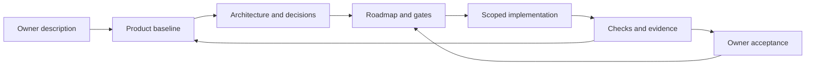

# FounDaTionZy

A documentation-first foundation for developing applications with humans and AI
agents. It gives a new project a shared memory, explicit decisions, a delivery
sequence, and a way to distinguish plans from verified behavior.

**Start by describing the application you want to build to an agent in as much
detail as possible.** Explain the problem, users, workflows, rules, constraints,
integrations, quality expectations, and what should stay out of scope. The agent
uses that discussion to fill the product documents, architecture, decisions,
roadmap, experiments, and project instructions. You do not need to know the
technical stack in advance.

This repository is a reusable documentation template. It contains working
documentation checks, but no application, chosen stack, or completed project
roadmap. Technical documentation is written in English; the initial discussion
can be in the owner's preferred language.

## Initialize a project

1. Create a repository from this template with **Use this template**, then clone
   your new repository. Decide its visibility separately; private application
   details should stay in an appropriately private repository.
2. Open that checkout with your agent and give it the prompt below, followed by
   your detailed application description.
3. Let the agent inspect existing material, ask focused questions, and populate
   the documentation. It must label recommendations and unknowns explicitly.
4. Review the resulting baseline, open decisions, and roadmap. Approving the
   baseline does not accept every proposed ADR or authorize all implementation.
5. When you are ready, explicitly select the first delivery step. The agent must
   resolve its due decisions before implementation.

Copy this prompt:

```text
Read AGENTS.md and docs/guides/bootstrap.md. Initialize this repository for
the application I describe below.

Start with documentation. Preserve all my requirements, explain your reasoning,
ask about important gaps, and separate confirmed requirements from proposals.
Populate the product baseline, user journeys, glossary, all twelve arc42
sections, relevant ADRs, open decisions, and a sequenced roadmap with per-step
prerequisites, deliverables, non-goals, exit criteria, and evidence requirements.
Adapt the agent instructions and development/operations guidance to the project.
Do not invent working commands, implementation evidence, or my approval.
Give me a reviewable baseline and identify the decisions needed for the next
step. Do not begin application implementation until I explicitly request it.

Here is the application I want to build:
[Describe the application in detail. Include examples and constraints.]
```

The [bootstrap guide](docs/guides/bootstrap.md) explains what to include, how the
agent turns the discussion into documents, and what a complete initialization
looks like.

## Understand the method



The loop matters: documentation guides implementation, and verified
implementation updates documentation. A plan, a merge, a passing test, and owner
acceptance each establish different facts.

- [Guide index and recommended reading paths](docs/guides/README.md)
- [How everything works and why](docs/guides/how-it-works.md)
- [Conventions and their rationale](docs/guides/conventions-and-rationale.md)
- [Agent lifecycle, handoffs, and review](docs/guides/agent-workflow.md)
- [Adopting the template in an existing project](docs/guides/adoption.md)
- [Documentation map and reading order](docs/README.md)
- [Contributing and Git workflow](CONTRIBUTING.md)

## What you get

| Area | Purpose |
| --- | --- |
| `AGENTS.md` and a thin `CLAUDE.md` entry point | One canonical set of repository instructions. |
| `docs/product/` | Requirements, scope, journeys, and domain language. |
| `docs/arc42/` and indexed ADRs | Architecture, alternatives, consequences, and decision status. |
| `docs/roadmap.md` and step documents | Delivery order, active scope, gates, and acceptance evidence. |
| `docs/open-decisions.md` | Questions with owners and explicit decision deadlines. |
| Experiments, workflow, development, and operations templates | Separate uncertain feasibility, behavioral contracts, developer commands, and runtime procedures. |
| PR template, formatting defaults, and documentation CI | Reviewable changes and repeatable structural checks. |

Run the included checks with Python 3.11 or newer:

```sh
python3 scripts/check_docs.py
git diff --check
```

These check documentation structure, relative links, anchors, fences, indexes,
and roadmap consistency. They do not prove application correctness or install
branch protection. See [development](docs/development.md).

FounDaTionZy is released under the [MIT License](LICENSE). Keep its notice with
reused template material; choose the application's own licensing deliberately.
